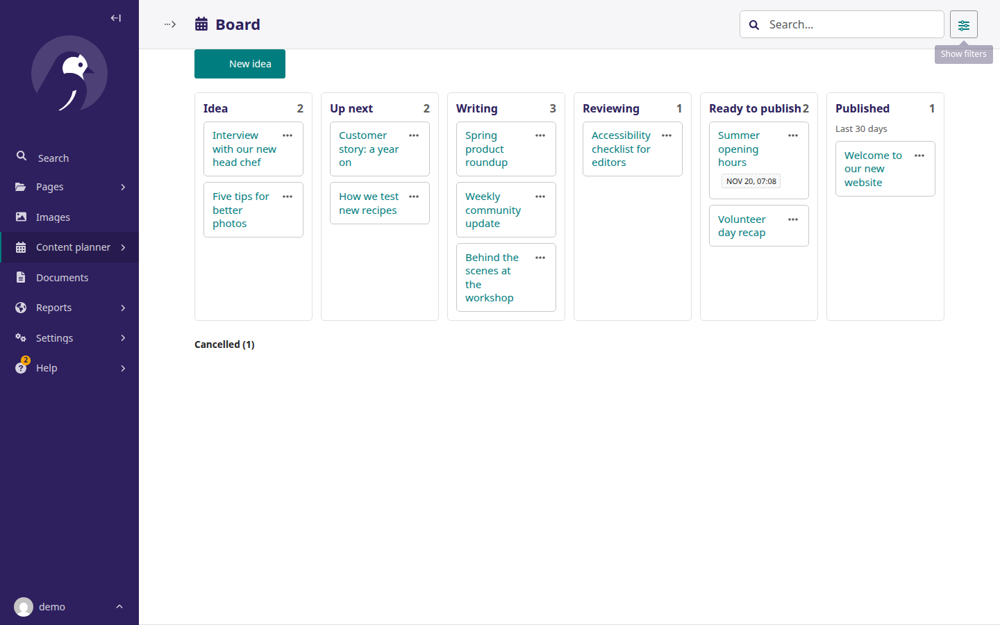
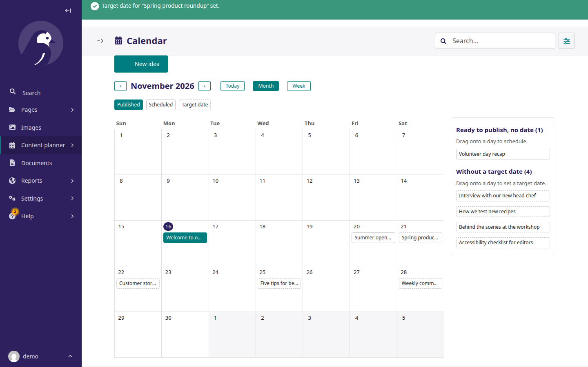
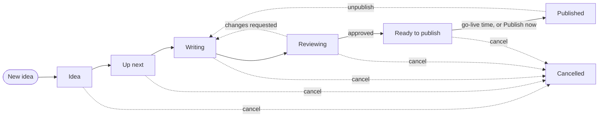
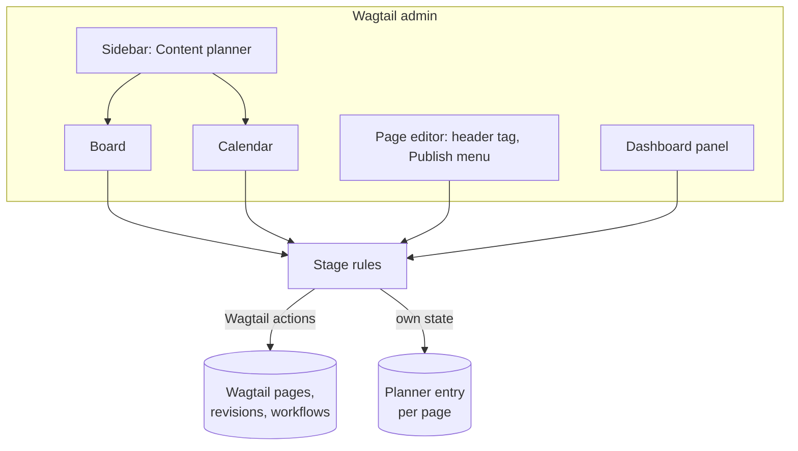
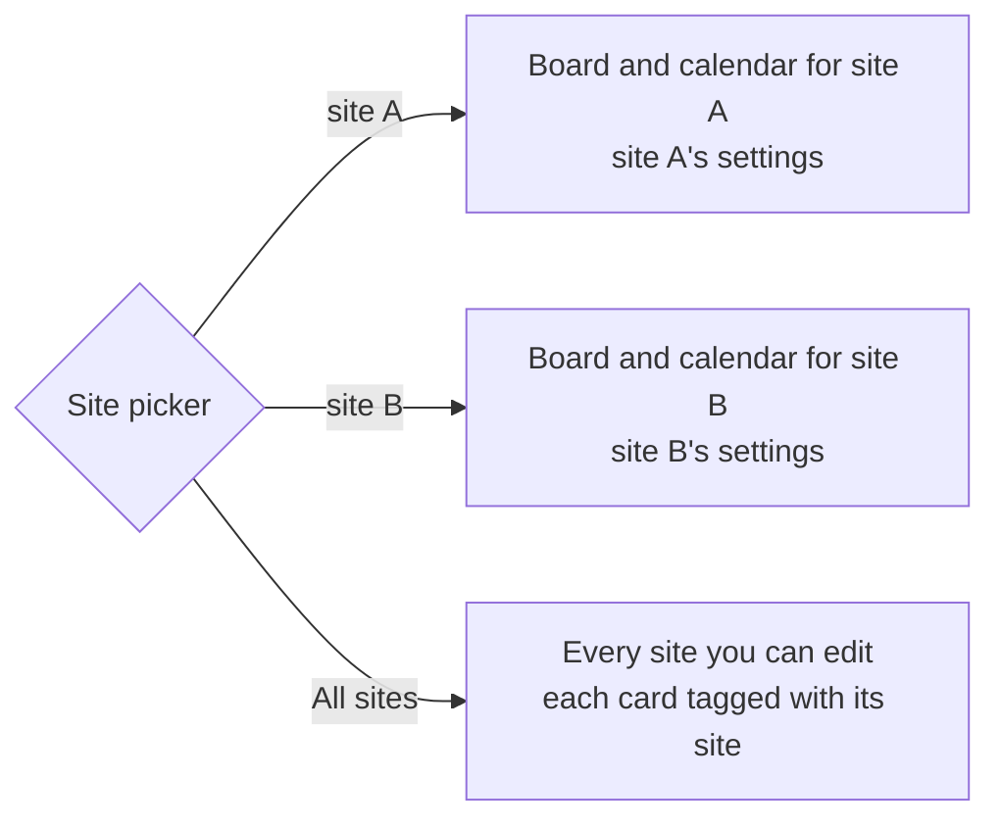
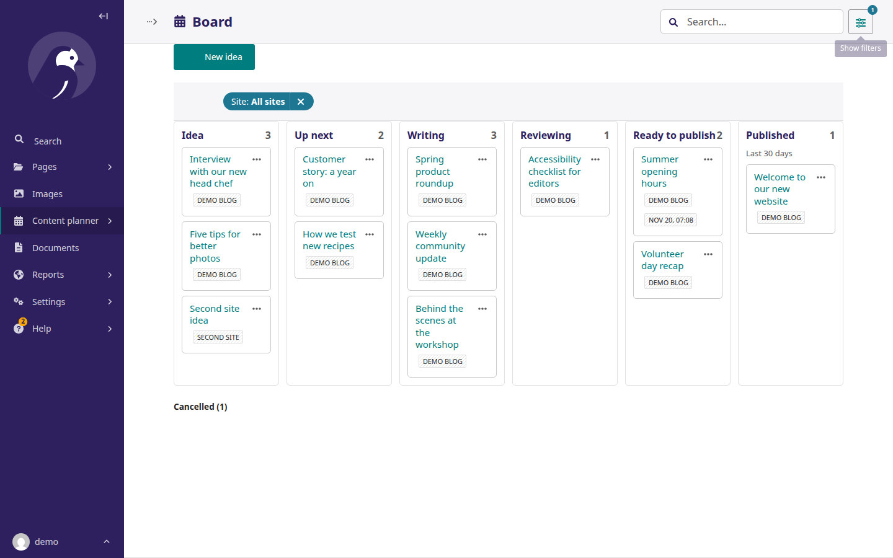
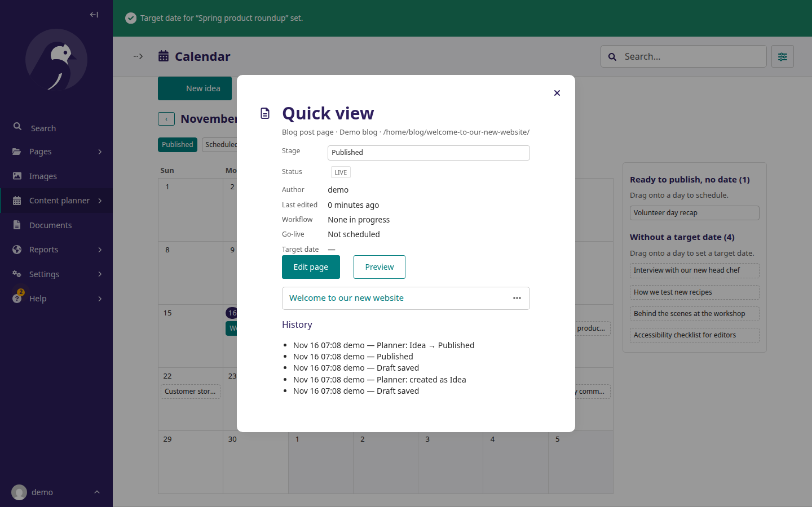
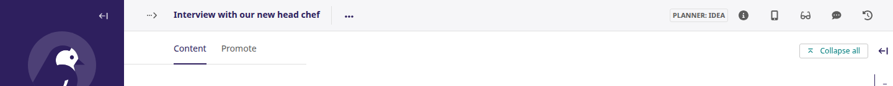
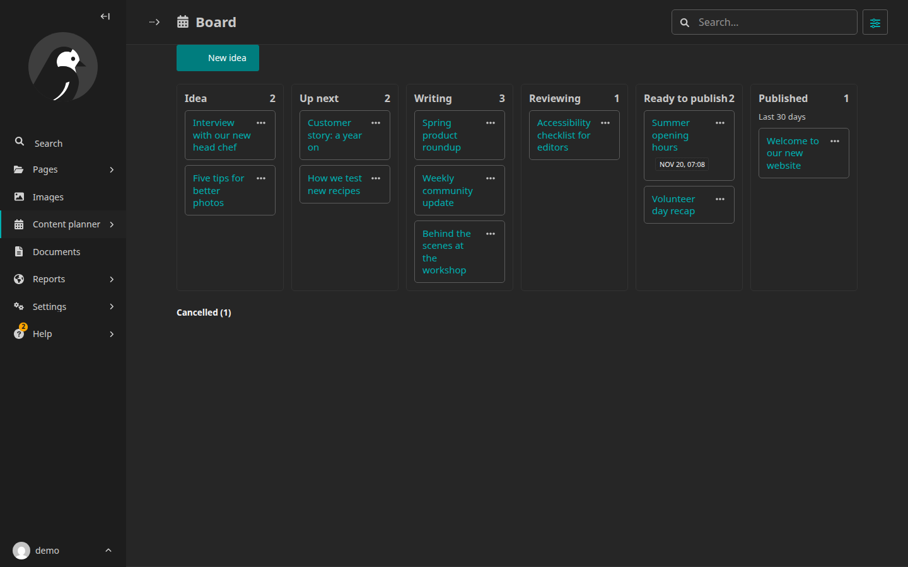

<p align="center">
  <b>wagtail-kanban-content-calendar</b><br>
  A kanban board and content calendar for Wagtail pages, inside the Wagtail admin.
</p>

<p align="center">
  <a href="https://pypi.org/project/wagtail-kanban-content-calendar/"></a>
  <a href="https://github.com/JR91387/wagtail-kanban-content-calendar/actions/workflows/test.yml"></a>
  
  
  
</p>

---

Plan your content where it already lives. Every card is a real Wagtail page, and every move runs one of
Wagtail's own actions: save a revision, submit to a workflow, schedule, publish or unpublish. Each move is
recorded in the page's history under the person who made it. There is no second database of "tasks" that
drifts out of date.


| Board | Calendar |
|---|---|
|  |  |

## Features

- **Board**: Idea → Up next → Writing → Reviewing → Ready to publish → Published, plus Cancelled. Drag a card,
  or use its ⋯ menu. Works without JavaScript too: every card has a plain Move form.
- **Calendar**: month and week views of published, scheduled and target-dated pages. Drag onto a day to
  schedule or set a target date.
- **One site or all sites**: a board and calendar per site, or an *All sites* view across every site you
  can edit.
- **Inside the editor**: the page's stage shows in the editor header, and *Move to Reviewing* /
  *Cancel this idea* appear in the Publish menu.
- **Dashboard**: an "Up next / This week" panel and a "scheduled this week" count.
- **Any page type**: you choose which page models are tracked. It works with any blog or news app, or your own
  page types.
- **Wagtail's rules, unchanged**: page permissions, page locks, workflows and scheduled publishing all behave
  exactly as they do in the normal editor. The planner only shows pages the user can edit.
- **Looks like Wagtail**: admin templates, the admin's Stimulus controllers, colour tokens and icons. No
  front-end build step and no extra JavaScript dependencies.

More detail, with screenshots, is in the [user guide](docs/wiki/Home.md).

## How it works



Most of the stage comes from Wagtail's own state. The add-on stores only what Wagtail has no field for.

| Stage | Where the stage comes from |
|---|---|
| Published | The page is live |
| Reviewing | A Wagtail workflow is in progress (or a plain stage, if you turn workflows off) |
| Ready to publish | A revision is scheduled (or approved and waiting for a date) |
| Idea, Up next, Writing, Cancelled | The add-on's own table, one row per page; your page models are never changed |



### One site, or all of them





Each site has its own settings: where new ideas go, starter text, week start, and whether Reviewing uses a
workflow.

| Quick view | Editor header | Dark theme |
|---|---|---|
|  |  |  |

## Requirements

| | Supported |
|---|---|
| Python | 3.11+ |
| Django | 5.2+ |
| Wagtail | 7.4 LTS+ (every release that still gets security fixes) |
| Database | PostgreSQL and SQLite (tested); other databases Wagtail supports should work |

## Installation

1. Install the package:

   ```bash
   pip install wagtail-kanban-content-calendar
   ```

2. Add it to `INSTALLED_APPS`, together with Wagtail's settings app if you don't already use it:

   ```python
   INSTALLED_APPS = [
       # ...
       "wagtail.contrib.settings",
       "wagtail_kanban_content_calendar",
   ]
   ```

3. Tell it which page types to track, and which field a new idea's starter text goes into:

   ```python
   WAGTAIL_KANBAN_PAGE_MODELS = {
       "blog.BlogPage": {"body_field": "body"},  # RichTextField
       "news.NewsPage": {
           "body_field": "content",
           "starter_block": "paragraph",
       },  # StreamField
   }
   ```

4. Create the tables and check the configuration:

   ```bash
   python manage.py migrate
   python manage.py check      # reports a misconfigured WAGTAIL_KANBAN_PAGE_MODELS
   ```

5. In the admin:
   - **Settings → Groups**: give editors **"Can use the content planner"**.
   - **Settings → Content planner** (per site): choose *Where new ideas go*.

6. Make sure scheduled publishing runs. Wagtail publishes scheduled pages only when its command runs, for
   example from cron every few minutes:

   ```cron
   */5 * * * * /path/to/venv/bin/python /path/to/manage.py publish_scheduled
   ```

   The board, calendar and dashboard warn you when a scheduled page is more than 15 minutes overdue.

### Settings reference

| Setting | Default | What it does |
|---|---|---|
| `WAGTAIL_KANBAN_PAGE_MODELS` | `{}` | Page models to track, as `"app_label.ModelName": {"body_field": ..., "starter_block": ...}` |

Per-site options live in **Settings → Content planner**.

## Upgrading

- **The add-on**: `pip install -U wagtail-kanban-content-calendar`, then `python manage.py migrate`. Changes are
  listed in [CHANGELOG.md](CHANGELOG.md).
- **Wagtail**: the add-on uses only Wagtail's documented hooks and public APIs, and changes no Wagtail code,
  templates or models. Each release is tested against the current Wagtail LTS, the latest release and Wagtail's
  `main` branch; see the compatibility table in [CHANGELOG.md](CHANGELOG.md).
- **Removing it**: take it out of `INSTALLED_APPS` after `python manage.py migrate wagtail_kanban_content_calendar zero`.
  Your pages are untouched, because the add-on never stored anything on them.

## Contributing

```bash
git clone https://github.com/JR91387/wagtail-kanban-content-calendar.git && cd wagtail-kanban-content-calendar
python -m venv .venv && . .venv/bin/activate
pip install -e . --group dev
pytest                                   # SQLite; DATABASE_URL=postgres://... for PostgreSQL
uvx --with tox-uv tox                    # every supported Wagtail and Django version
python testmanage.py migrate && python testmanage.py createcachetable
python testmanage.py planner_demo   # demo pages in every stage; log in as demo / demo-password
python testmanage.py runserver
```

Bug reports and pull requests are welcome; see [CONTRIBUTING.md](CONTRIBUTING.md). Report security issues
privately as described in [SECURITY.md](SECURITY.md).

## Thank you

- **[Wagtail](https://wagtail.org)** and its contributors, for a CMS whose hooks, workflows and scheduled
  publishing made this possible without changing a line of Wagtail.
- **[cookiecutter-wagtail-package](https://github.com/wagtail/cookiecutter-wagtail-package)**, the official
  add-on template this project started from.
- **[wagtail-calendar](https://pypi.org/project/wagtail-calendar/)**, the earlier calendar add-on for the Wagtail
  admin, which showed how useful a content calendar inside Wagtail can be.

## License

MIT. See [LICENSE](LICENSE).
