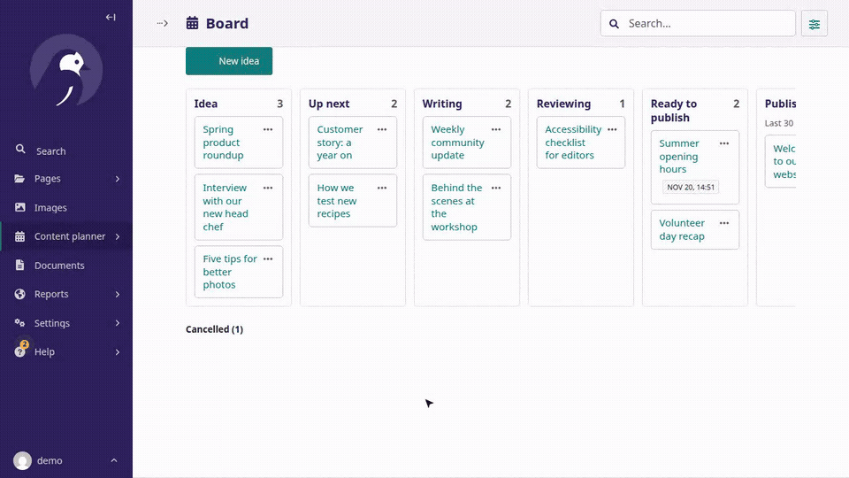
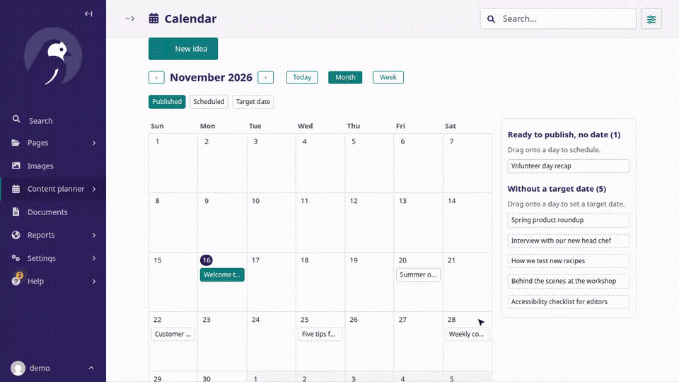

# wagtail-kanban-content-calendar

A kanban board and editorial content calendar for the Wagtail CMS. Editors plan, schedule and publish
Wagtail pages from inside the Wagtail admin, on any Django site that runs Wagtail 7.4 or later.

Each card on the board is a real Wagtail page. Dragging a card runs the same action the page editor would run:
it saves a revision, submits the page to a workflow, schedules it, publishes it or unpublishes it. The page
history records each move under the editor who made it, so nobody keeps a second task list in sync by hand.

It suits blogs, news sites and marketing teams that already publish with Wagtail and want an editorial calendar
without another tool.





## Features

- **Kanban board.** Columns run Idea, Up next, Writing, Reviewing, Ready to publish and Published, with Cancelled
  below. Drag a card or use its ⋯ menu. Without JavaScript, every card has a plain Move form.
- **Content calendar.** Month and week views. Drag a page onto a day to schedule it or give it a target date.
- **Multi-site.** Each Wagtail site gets its own board and calendar, and an All sites view shows every site you
  can edit.
- **Page editor.** The page header shows the stage, and the Publish menu has the stage moves.
- **Dashboard.** The Wagtail dashboard gets an "Up next / This week" panel and a count of pages scheduled this week.
- **Any page type.** You pick which page models appear, so it works with your own blog or news models.
- **Wagtail permissions.** Page permissions, locks, workflows and scheduled publishing behave as they do in the
  normal editor.
- **Built from the Wagtail admin.** It uses Wagtail's templates, Stimulus controllers, colour tokens, icons and
  themes. There is no front-end build and no extra JavaScript dependency.

| All sites | Dark theme |
|---|---|
|  |  |

The user guide is on the [wiki](https://github.com/JR91387/wagtail-kanban-content-calendar/wiki).

## How it works


| Stage | Where the stage comes from |
|---|---|
| Published | The page is live |
| Reviewing | A Wagtail workflow is in progress (or a plain stage, if you turn workflows off) |
| Ready to publish | A revision is scheduled (or approved and waiting for a date) |
| Idea, Up next, Writing, Cancelled | The add-on's own table, one row per page. It never changes your page models. |

## Requirements

| | Supported |
|---|---|
| Python | 3.11+ |
| Django | 5.2+ |
| Wagtail | 7.4 LTS+ (every release that still gets security fixes) |
| Database | PostgreSQL and SQLite (tested); other databases Wagtail supports should work |

## Installation

1. Install the package:

   ```bash
   pip install wagtail-kanban-content-calendar
   ```

2. Add it to `INSTALLED_APPS`, together with Wagtail's settings app if you don't already use it:

   ```python
   INSTALLED_APPS = [
       # ...
       "wagtail.contrib.settings",
       "wagtail_kanban_content_calendar",
   ]
   ```

3. Tell it which page types to track, and which field a new idea's starter text goes into:

   ```python
   WAGTAIL_KANBAN_PAGE_MODELS = {
       "blog.BlogPage": {"body_field": "body"},  # RichTextField
       "news.NewsPage": {
           "body_field": "content",
           "starter_block": "paragraph",
       },  # StreamField
   }
   ```

4. Create the tables and check the configuration:

   ```bash
   python manage.py migrate
   python manage.py check      # reports a misconfigured WAGTAIL_KANBAN_PAGE_MODELS
   ```

5. In the admin:
   - **Settings → Groups**: give editors **"Can use the content planner"**.
   - **Settings → Content planner** (per site): choose *Where new ideas go*.

6. Make sure scheduled publishing runs. Wagtail publishes scheduled pages only when its command runs, for
   example from cron every few minutes:

   ```cron
   */5 * * * * /path/to/venv/bin/python /path/to/manage.py publish_scheduled
   ```

   The board, calendar and dashboard warn you when a scheduled page is more than 15 minutes overdue.

All settings are listed on the wiki's [Settings](https://github.com/JR91387/wagtail-kanban-content-calendar/wiki/Settings) page.

## Upgrading

`pip install -U wagtail-kanban-content-calendar`, then `python manage.py migrate`. See [CHANGELOG.md](https://github.com/JR91387/wagtail-kanban-content-calendar/blob/main/CHANGELOG.md).
Removing it: `python manage.py migrate wagtail_kanban_content_calendar zero`, then take it out of
`INSTALLED_APPS`. Your pages are untouched.

## Contributing

```bash
git clone https://github.com/JR91387/wagtail-kanban-content-calendar.git && cd wagtail-kanban-content-calendar
python -m venv .venv && . .venv/bin/activate
pip install -e . --group dev
pytest                                   # SQLite; DATABASE_URL=postgres://... for PostgreSQL
uvx --with tox-uv tox                    # every supported Wagtail and Django version
python testmanage.py migrate && python testmanage.py createcachetable
python testmanage.py planner_demo   # demo pages in every stage; log in as demo / demo-password
python testmanage.py runserver
```

Bug reports and pull requests are welcome; see [CONTRIBUTING.md](https://github.com/JR91387/wagtail-kanban-content-calendar/blob/main/CONTRIBUTING.md). Report security issues
privately as described in [SECURITY.md](https://github.com/JR91387/wagtail-kanban-content-calendar/blob/main/SECURITY.md).

## Thank you

- **[Wagtail](https://wagtail.org)** and its contributors, for a CMS whose hooks, workflows and scheduled
  publishing made this possible without changing a line of Wagtail.
- **[cookiecutter-wagtail-package](https://github.com/wagtail/cookiecutter-wagtail-package)**, the official
  add-on template this project started from.
- **[wagtail-calendar](https://pypi.org/project/wagtail-calendar/)**, the earlier calendar add-on for the Wagtail
  admin, which showed how useful a content calendar inside Wagtail can be.

## Author

Built by [Jerry Reinitz](https://JerryReinitz.com), a software engineer in Tulsa, Oklahoma, and the founder of
Reinitz Industries.

## License

MIT. See [LICENSE](https://github.com/JR91387/wagtail-kanban-content-calendar/blob/main/LICENSE).

---

**More from Reinitz Industries:** [Job-o-Matic](https://github.com/JR91387/jobomatic-reusme-skills-database) · [Preen](https://github.com/JR91387/Preen-AI-email-sorting) · [/bully](https://github.com/JR91387/claude-skill-bully) · [/bruh](https://github.com/JR91387/claude-skill-bruh) · [Calendar Forge](https://github.com/JR91387/calendar-forge-ics)
