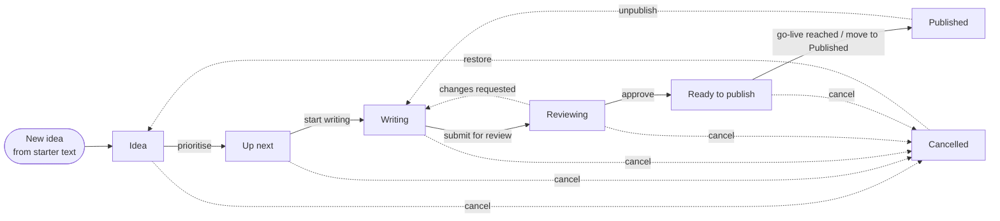

# Content flow

**Idea → Up next → Writing → Reviewing → Ready to publish → Published**, or **Cancelled**.

| # | Stage | Wagtail state | What the move does in Wagtail | Reversible |
|---|---|---|---|---|
| 1 | Idea | Draft page (never published) + planner entry | "New idea" creates a draft of a tracked page type under the site's chosen parent, body from the starter text | Yes (cancel) |
| 2 | Up next | Draft + planner entry | Planner entry change only (logged in page history) | Yes |
| 3 | Writing | Draft + planner entry | Planner entry change; the page is edited in the normal Wagtail editor | Yes |
| 4 | Reviewing | **Workflow in progress** when the page's section has a workflow; otherwise the planner entry | With a workflow: Wagtail's own "Submit for moderation" (moderators see it on their dashboard). Without: planner entry change | Yes (changes requested → Writing) |
| 5 | Ready to publish | Approved: either **scheduled** (go-live on the revision) or waiting for a date | Setting a date uses Wagtail's scheduled publishing; no date keeps the planner entry until one is set | Yes (unschedule) |
| 6 | Published | **Live** | Wagtail publishes the revision, at the go-live time or straight away | Yes (unpublish → Writing) |
| 7 | Cancelled | Draft + "cancelled" planner entry; never deleted | Hidden from the main columns (shown on demand); restore returns it to Idea | Yes (restore) |

Every move is saved as a revision or log entry under the person who made it, and Wagtail's page permissions decide
who may make it. Scheduled pages go live only when Wagtail's `publish_scheduled` command runs.
