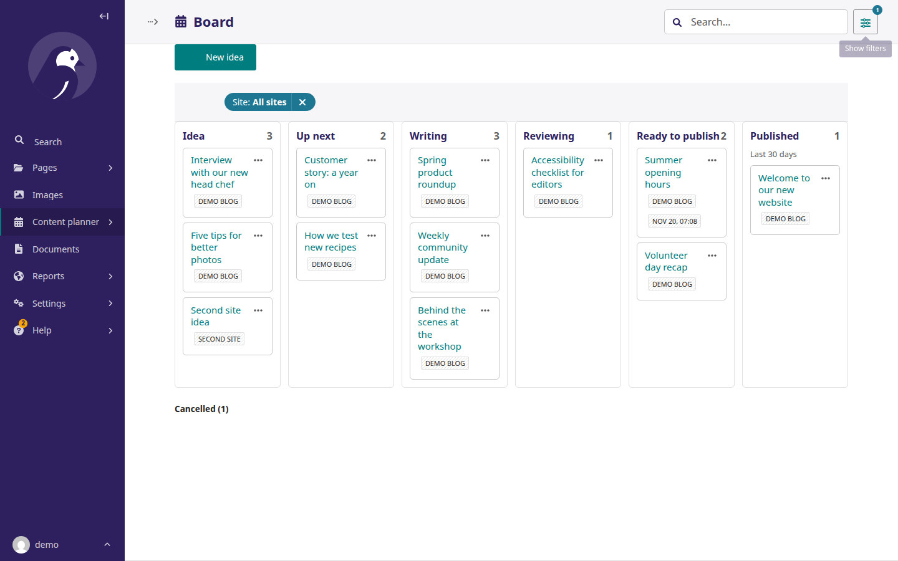

# Sites and languages

The Board and Calendar show the site you are browsing. Choose another site in the filters, or **All sites** to
see every site you can edit at once, with each card naming its site.

- Each site keeps its own settings: where new ideas go, starter text, week start, and whether Reviewing uses a
  workflow.
- **New idea** asks which site when there is more than one.
- The dashboard panel shows the current site and links to the All-sites board.
- **Multilingual sites** (`WAGTAIL_I18N_ENABLED`): Wagtail's own locale filter appears, and while no locale is
  chosen each card names its language.
