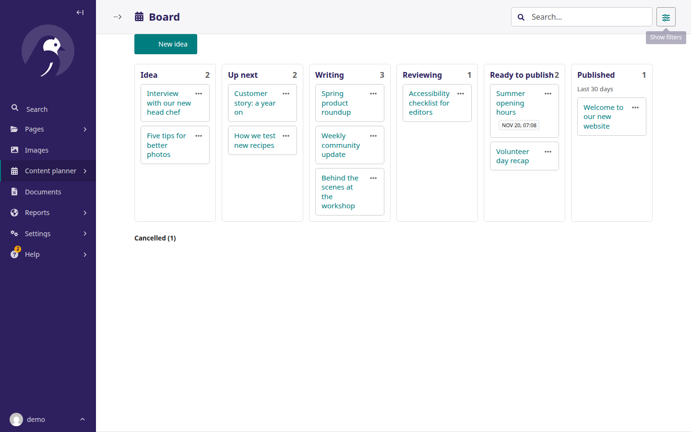
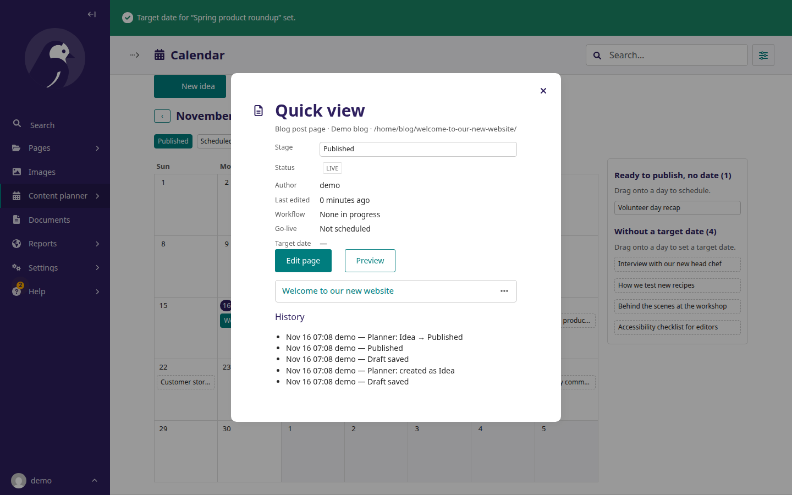
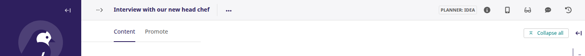
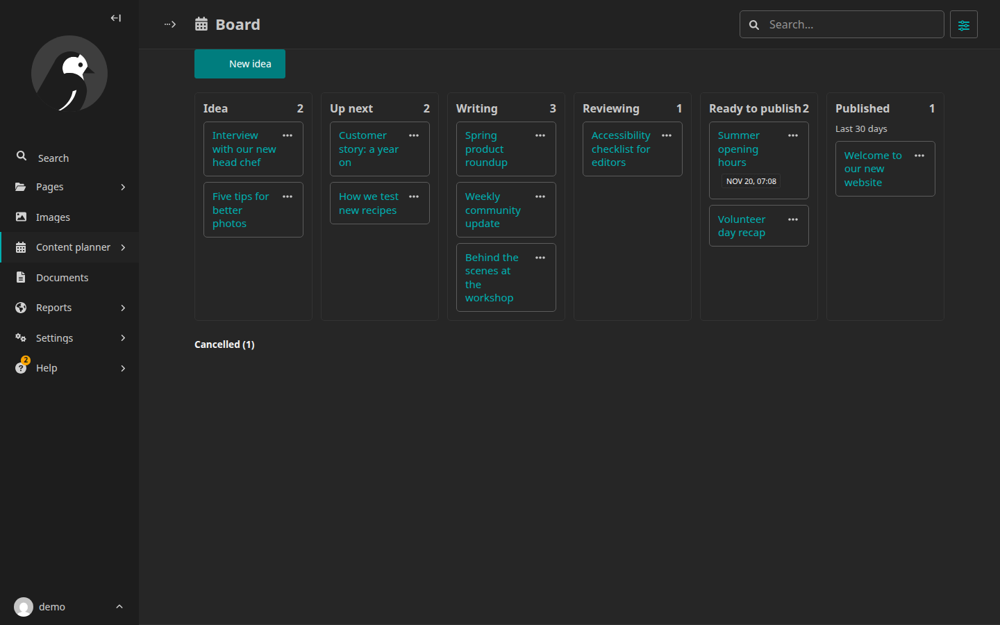

# Using the Board

**Content planner → Board** shows six columns, Idea, Up next, Writing, Reviewing, Ready to publish and Published,
with Cancelled cards tucked below.

- **Move a card** by dragging it to another column, or with its **⋯** menu. Every move is a Wagtail action: a
  revision, a workflow submission or cancellation, a schedule, a publish or an unpublish. Moves that unpublish,
  cancel a schedule or cancel a workflow ask first.
- **Cards show only the title**, plus a small label when something needs attention: overdue, locked by someone
  else, a go-live time, or a target date due or missed.
- **Search and filter** from Wagtail's own header: site, page type, my pages only, show cancelled.
- **New idea** creates a draft page from the site's starter text.
- **Quick view**: click a title to see the stage, Wagtail's own status, author, workflow, go-live, target date
  and recent history, with Edit and Preview.

## In the page editor

The page's stage shows as a tag in the editor header. *Move to Up next*, *Move to Reviewing* and *Cancel this
idea* appear in the Publish menu and bring you back to the editor.

## Refused moves

A move changes nothing, and says why, when the page changed since the board loaded, when you lack the Wagtail
permission it needs, or when another editor has locked the page.

The board follows Wagtail's light, dark and high-contrast themes:

