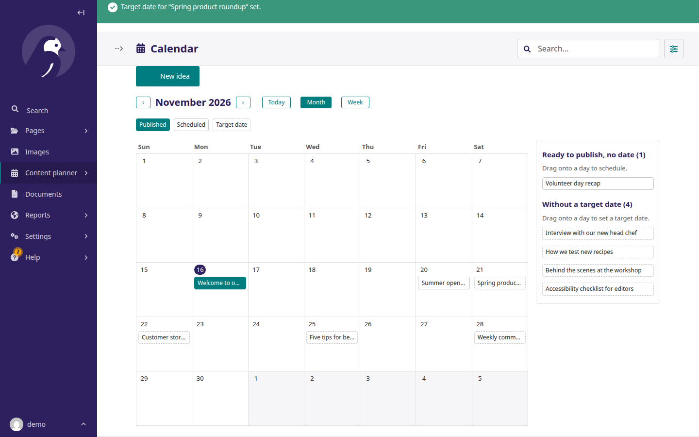

# Using the Calendar

**Content planner → Calendar** shows published, scheduled and target-dated pages by month or week.

- **Ready to publish, no date**: drag onto a day to schedule it (you pick the time).
- **Without a target date**: drag onto a day to set a target date. A target date is a plan, not a schedule; it
  never publishes anything.
- Click any item for its quick view. The week starts on the day chosen in Settings → Content planner.
